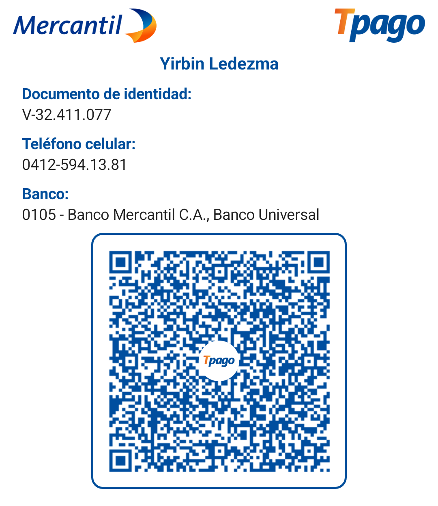

MultiStore Cloud - Cerebro Técnico
App.js:
/**
 * Cerebro Central de la Plataforma Multi-Tienda (Cloudflare D1 Conectado)
 */

const API_BASE_URL = 'https://api-multistore.ledezmayirbin.workers.dev/api';

/**
 * Obtiene la base de datos completa conectándose a Cloudflare D1.
 * Aplica el cálculo en tiempo real de los días restantes basados en la fecha de registro.
 */
async function obtenerBaseDatos() {
    try {
        const response = await fetch(`${API_BASE_URL}/obtener-db?_t=${Date.now()}`, {
            cache: 'no-store'
        });
        
        if (!response.ok) throw new Error("Error al conectar con la base de datos en la nube.");
        let data = await response.json();
        
        if (!data || typeof data !== 'object') {
            return {};
        }

        // Procesar automáticamente los días restantes reales para cada tienda
        const ahora = new Date();
        let dbModificada = false;

        Object.keys(data).forEach(slug => {
            const tienda = data[slug];
            
            // Si la tienda es antigua y no tiene fecha de registro guardada, 
            // establecemos hoy como su punto de partida real para que el descuento empiece a correr desde este momento.
            if (!tienda.fechaRegistro) {
                tienda.fechaRegistro = ahora.toISOString();
                // Si ya tenía días asignados (ej: 90 o 15), los respetamos como su total inicial
                if (tienda.diasTotalesOtorgados === undefined) {
                    tienda.diasTotalesOtorgados = tienda.diasSolventes !== undefined ? tienda.diasSolventes : 15;
                }
                dbModificada = true;
            }

            // Cálculo en tiempo real basado en la fecha de registro
            if (tienda.fechaRegistro) {
                const fechaReg = new Date(tienda.fechaRegistro);
                const diasOtorgados = tienda.diasTotalesOtorgados || 15;
                
                const diferenciaMs = ahora - fechaReg;
                const diasPasados = Math.floor(diferenciaMs / (1000 * 60 * 60 * 24));
                
                let diasRestantesReales = diasOtorgados - diasPasados;
                if (diasRestantesReales < 0) diasRestantesReales = 0;
                
                tienda.diasSolventes = diasRestantesReales;

                if (diasRestantesReales === 0 && slug !== 'superadmin') {
                    tienda.bloqueado = true;
                }
            }
        });

        // Sincronizar si se fijó la fecha base por primera vez
        if (dbModificada) {
            guardarBaseDatos(data);
        }
        
        return data;
    } catch (err) {
        console.warn("Usando respaldo local por fallo de red:", err);
        const dbLocal = localStorage.getItem('multi_tiendas_db');
        if (!dbLocal) return {};
        try {
            return JSON.parse(dbLocal) || {};
        } catch {
            return {};
        }
    }
}

/**
 * Guarda o actualiza la base de datos completa enviándola al Cloudflare Worker.
 * (Protegido contra el error de cuota excedida de localStorage por imágenes pesadas)
 */
async function guardarBaseDatos(nuevaDb) {
    try {
        try {
            localStorage.setItem('multi_tiendas_db', JSON.stringify(nuevaDb));
        } catch (storageErr) {
            console.warn("Aviso: El localStorage se llenó por el peso de las imágenes, pero la nube Cloudflare D1 recibirá los datos.");
        }

        const response = await fetch(`${API_BASE_URL}/guardar-db`, {
            method: 'POST',
            headers: { 'Content-Type': 'application/json' },
            body: JSON.stringify(nuevaDb)
        });

        if (!response.ok) throw new Error("No se pudo sincronizar con Cloudflare D1.");
        return true;
    } catch (err) {
        console.error("Error al guardar en la nube:", err);
        return false;
    }
}

/**
 * Registro rápido y limpio conectado directamente a la API en la nube.
 * Se asegura de enviar la fecha de registro y los 15 días iniciales por defecto.
 */
async function registrarNuevaTienda({ usuario, password, nombreTienda, whatsapp }) {
    try {
        const response = await fetch(`${API_BASE_URL}/registrar-tienda`, {
            method: 'POST',
            headers: { 'Content-Type': 'application/json' },
            body: JSON.stringify({ 
                usuario, 
                password, 
                nombreTienda, 
                whatsapp,
                fechaRegistro: new Date().toISOString(),
                diasTotalesOtorgados: 15
            })
        });

        const resultado = await response.json();
        if (!response.ok) {
            throw new Error(resultado.error || "El nombre de usuario o identificador de tienda ya está en uso. Elige otro.");
        }

        return true;
    } catch (err) {
        throw new Error(err.message);
    }
}

/**
 * Utilidad global para extraer parámetros limpios de la URL (ej: ?tienda=tu_tienda)
 */
function obtenerParametroURL(nombre) {
    const urlParams = new URLSearchParams(window.location.search);
    return urlParams.get(nombre);
}

auth-guard.js:
/**
 * Auth Guard - MultiStore Cloud
 * Protege las rutas de administración y superadmin verificando sesiones y días solventes.
 */
(function () {
    const paginaActual = window.location.pathname.split("/").pop();

    // 1. EVALUAR RUTA DE SUPERADMIN
    if (paginaActual === "superadmin.html") {
        const sesionSuper = localStorage.getItem("sesion_superadmin");
        if (!sesionSuper) {
            alert("Acceso denegado: Se requiere rol de Superadministrador.");
            window.location.href = "login.html";
            return;
        }
        // Si existe la sesión de superadmin, permitimos el paso libre
        return;
    }

    // 2. EVALUAR RUTA DE ADMINISTRADOR DE TIENDA (admin.html)
    if (paginaActual === "admin.html" || paginaActual === "admin_2.html") {
        const tiendaSlug = localStorage.getItem("sesion_vendedor");

        // Verificar si existe el token de sesión del vendedor
        if (!tiendaSlug) {
            alert("Acceso denegado: Debe iniciar sesión con su tienda para acceder al panel.");
            window.location.href = "login.html";
            return;
        }

        // Validación cruzada de la base de datos (Cloudflare / LocalStorage) para chequear bloqueo o vencimiento
        try {
            const dbLocal = localStorage.getItem("multi_tiendas_db");
            if (dbLocal) {
                const db = JSON.parse(dbLocal);
                const tienda = db[tiendaSlug.trim().toLowerCase()];

                if (tienda) {
                    // Verificar si la tienda está bloqueada por suscripción vencida
                    if (tienda.bloqueado === true || Number(tienda.diasSolventes) <= 0) {
                        // Si ya está en la pantalla de vencido o el panel, el script de admin se encarga 
                        // de mostrar la vista de renovación, pero aquí podemos forzar una alerta si intentan evadirlo.
                        console.warn("Aviso de seguridad: La tienda tiene la suscripción inactiva.");
                    }
                }
            }
        } catch (e) {
            console.error("Error al validar el estado de la tienda en el AuthGuard:", e);
        }
    }
})();

// Función auxiliar global para limpiar sesiones y expulsar al login
function cerrarSesionYSalir() {
    localStorage.removeItem("sesion_vendedor");
    localStorage.removeItem("sesion_superadmin");
    window.location.href = "login.html";
}

index.html:

<!DOCTYPE html>
<html lang="es" class="dark">
<head>
    <meta charset="UTF-8">
    <meta name="viewport" content="width=device-width, initial-scale=1.0">
    <title>Plataforma Multi-Tienda - Cloudflare Edge</title>
    <link href="https://cdn.jsdelivr.net/npm/bootstrap@5.3.3/dist/css/bootstrap.min.css" rel="stylesheet">
    
    
</head>
<body id="page-body" class="bg-darkbg text-slate-100 font-sans min-h-screen flex flex-col justify-between selection:bg-amber-500 selection:text-white">

    <header class="w-full border-b border-slate-800/80 backdrop-blur-md bg-darkbg/80 sticky top-0 z-50 shadow-md">
        

            

                

                    <svg class="w-5 h-5 sm:w-6 sm:h-6 text-white" fill="none" stroke="currentColor" viewBox="0 0 24 24">
                        <path stroke-linecap="round" stroke-linejoin="round" stroke-width="2" d="M16 11V7a4 4 0 00-8 0v4M5 9h14l1 12H4L5 9z"></path>
                    </svg>
                

                MultiStore Cloud
            

            

        

    </header>

    <!-- Contenedor principal -->
    <main class="max-w-7xl mx-auto px-3 sm:px-6 py-6 sm:py-8 flex-grow w-full">
        
        <!-- VISTA 1: Bienvenida -->
        

            

                
                    Plataforma Global Multi-Tienda
                
                <h1 class="text-3xl sm:text-6xl font-black tracking-tight text-white leading-tight">
                    Bienvenido a tu ecosistema digital
                </h1>
                

                    Selecciona cómo deseas ingresar a la plataforma el día de hoy para continuar con tu experiencia personalizada.
                

            

            

                <button onclick="mostrarVistaCliente()" class="group relative p-6 sm:p-8 rounded-2xl sm:rounded-3xl bg-cardbg border border-slate-800 hover:border-amber-500/50 transition-all duration-300 hover:shadow-2xl hover:shadow-amber-500/10 text-left flex flex-col justify-between">
                    

                    

                        

                            <svg class="w-6 h-6 sm:w-7 sm:h-7" fill="none" stroke="currentColor" viewBox="0 0 24 24">
                                <path stroke-linecap="round" stroke-linejoin="round" stroke-width="2" d="M16 11V7a4 4 0 00-8 0v4M5 9h14l1 12H4L5 9z"></path>
                            </svg>
                        

                        

                            <h2 class="text-xl sm:text-2xl font-bold text-white group-hover:text-amber-400 transition-colors">Soy Cliente</h2>
                            
Explora catálogos de tiendas y realiza pedidos directos por WhatsApp.

                        

                    

                    

                        Explorar tiendas
                        <svg class="w-4 h-4 ml-2 group-hover:translate-x-1 transition-transform" fill="none" stroke="currentColor" viewBox="0 0 24 24">
                            <path stroke-linecap="round" stroke-linejoin="round" stroke-width="2" d="M9 5l7 7-7 7"></path>
                        </svg>
                    

                </button>

                <button onclick="window.location.href='login.html'" class="group relative p-6 sm:p-8 rounded-2xl sm:rounded-3xl bg-cardbg border border-slate-800 hover:border-orange-500/50 transition-all duration-300 hover:shadow-2xl hover:shadow-orange-500/10 text-left flex flex-col justify-between">
                    

                    

                        

                            <svg class="w-6 h-6 sm:w-7 sm:h-7" fill="none" stroke="currentColor" viewBox="0 0 24 24">
                                <path stroke-linecap="round" stroke-linejoin="round" stroke-width="2" d="M10.325 4.317c.426-1.756 2.924-1.756 3.35 0a1.724 1.724 0 002.573 1.066c1.543-.94 3.31.826 2.37 2.37a1.724 1.724 0 001.065 2.572c1.756.426 1.756 2.924 0 3.35a1.724 1.724 0 00-1.066 2.573c.94 1.543-.826 3.31-2.37 2.37a1.724 1.724 0 00-2.572 1.065c-.426 1.756-2.924 1.756-3.35 0a1.724 1.724 0 00-2.573-1.066c-1.543.94-3.31-.826-2.37-2.37a1.724 1.724 0 00-1.065-2.572c-1.756-.426-1.756-2.924 0-3.35a1.724 1.724 0 001.066-2.573c-.94-1.543.826-3.31 2.37-2.37.996.608 2.296.07 2.572-1.065z"></path>
                            </svg>
                        

                        

                            <h2 class="text-xl sm:text-2xl font-bold text-white group-hover:text-orange-400 transition-colors">Soy Administrador</h2>
                            
Inicia sesión para gestionar el inventario y personalizar tu tienda.

                        

                    

                    

                        Iniciar sesión
                        <svg class="w-4 h-4 ml-2 group-hover:translate-x-1 transition-transform" fill="none" stroke="currentColor" viewBox="0 0 24 24">
                            <path stroke-linecap="round" stroke-linejoin="round" stroke-width="2" d="M9 5l7 7-7 7"></path>
                        </svg>
                    

                </button>
            

        

        <!-- VISTA 2: Selector de Tiendas -->
        

            

                

                    <button onclick="regresarInicio()" class="text-xs font-semibold text-amber-400 hover:text-amber-300 flex items-center mb-1">
                        ← Volver al inicio
                    </button>
                    <h2 class="text-2xl sm:text-3xl font-black text-white">Explora nuestras tiendas</h2>
                    
Elige la tienda de tu preferencia para ver su catálogo exclusivo.

                

            

            

                <input type="text" id="input-buscar-tienda" oninput="filtrarTiendas()" placeholder="Buscar tienda por nombre..." class="w-full bg-cardbg border border-slate-800 rounded-2xl px-5 py-3 text-xs sm:text-sm text-white focus:outline-none focus:border-amber-500 placeholder-slate-500 shadow-inner">
            

            

        

        
        <!-- VISTA 3: Vitrina de Productos con Búsqueda y Categorías Inteligentes -->
        

            

                

                    <button onclick="mostrarVistaCliente()" class="text-xs font-semibold text-amber-400 hover:text-amber-300 flex items-center mb-1">
                        ← Volver al listado
                    </button>
                    <h2 id="vitrina-titulo" class="text-xl sm:text-2xl font-black text-white">Catálogo de Productos</h2>
                    
Haz clic en cualquier producto para ver su vista previa ampliada y pedir vía WhatsApp.

                

            

            <!-- BARRA DE BÚSQUEDA Y FILTROS INTELIGENTES POR CATEGORÍA -->
            

                

                    <input type="text" id="input-buscar-producto" oninput="filtrarProductosVitrina()" placeholder="Buscar producto en esta tienda..." class="w-full bg-cardbg border border-slate-800 rounded-2xl px-4 py-3 text-xs sm:text-sm text-white focus:outline-none focus:border-amber-500 placeholder-slate-500 shadow-inner">
                

                <!-- Contenedor dinámico: Solo muestra las categorías que tienen stock real -->
                

            

            

                

                    

                    
Cargando catálogo...

                

            

        

    </main>

    <!-- MODAL DE VISTA PREVIA AMPLIADA DEL PRODUCTO -->
    

        

            

                <button type="button" class="btn-close btn-close-white absolute top-4 right-4" data-bs-dismiss="modal" aria-label="Close"></button>
                

                    

                        
                    

                    

                        
                        <h3 id="modal-prod-nombre" class="text-xl sm:text-2xl font-black text-white"></h3>
                        

                        

                        

                            
<strong>Tallas:</strong> 

                            
<strong>Colores:</strong> 

                        

                        

                            <a id="modal-prod-btn-whatsapp" href="#" target="_blank" class="w-full bg-gradient-to-r from-emerald-600 to-teal-600 hover:from-emerald-500 hover:to-teal-500 text-white font-bold py-3 px-5 rounded-xl transition shadow-lg flex items-center justify-center gap-2 text-xs sm:text-sm">
                                🛍️ Pedir por WhatsApp
                            </a>
                        

                    

                

            

        

    

    <footer class="w-full border-t border-slate-800 py-6 text-center text-xs text-slate-500">
        Plataforma Multi-Tienda Cloudflare Edge &copy; 2026.
    </footer>

    
    
    
</body>
</html>

admin.html:

<!DOCTYPE html>
<html lang="es" class="dark">
<head>
    <meta charset="UTF-8">
    <meta name="viewport" content="width=device-width, initial-scale=1.0">
    <title>Panel de Administración - MultiStore Cloud</title>
    <link href="https://cdn.jsdelivr.net/npm/bootstrap@5.3.3/dist/css/bootstrap.min.css" rel="stylesheet">
    
    
</head>
<body class="bg-darkbg text-slate-100 font-sans min-h-screen flex flex-col justify-between selection:bg-amber-500 selection:text-white">

    <header class="w-full border-b border-slate-800 backdrop-blur-md bg-darkbg/80 sticky top-0 z-50">
        

            

                

                    <svg class="w-5 h-5 sm:w-6 sm:h-6 text-white" fill="none" stroke="currentColor" viewBox="0 0 24 24"><path stroke-linecap="round" stroke-linejoin="round" stroke-width="2" d="M16 11V7a4 4 0 00-8 0v4M5 9h14l1 12H4L5 9z"></path></svg>
                

                

                    Mi Tienda
                    Cloudflare Edge
                

            

            

                <a id="link-ver-tienda" href="#" target="_blank" class="btn btn-outline-light btn-sm rounded-xl px-2.5 py-1.5 sm:px-3 sm:py-2 text-[11px] sm:text-xs font-semibold">
                    Ver Vitrina ↗
                </a>
                <button onclick="cerrarSesion()" class="btn btn-danger btn-sm rounded-xl px-2.5 py-1.5 sm:px-3 sm:py-2 text-[11px] sm:text-xs font-semibold">
                    Salir
                </button>
            

        

    </header>

    <main class="max-w-7xl mx-auto px-4 sm:px-6 py-6 sm:py-10 flex-grow w-full space-y-6 sm:space-y-10">
        
        <!-- PANTALLA DE BLOQUEO / SUSCRIPCIÓN VENCIDA -->
        <section id="pantalla-suscripcion-vencida" class="hidden max-w-xl mx-auto my-12 bg-cardbg border border-rose-500/30 rounded-3xl p-6 sm:p-8 shadow-2xl text-center space-y-6">
            

                <svg class="w-8 h-8" fill="none" stroke="currentColor" viewBox="0 0 24 24"><path stroke-linecap="round" stroke-linejoin="round" stroke-width="2" d="M12 9v2m0 4h.01m-6.938 4h13.856c1.54 0 2.502-1.667 1.732-3L13.732 4c-.77-1.333-2.694-1.333-3.464 0L3.34 16c-.77 1.333.192 3 1.732 3z"></path></svg>
            

            
            

                
                    Suscripción Inactiva
                
                <h2 class="text-2xl font-black text-white">Tu tienda está suspendida</h2>
                

                    El periodo de vigencia ha expirado. Elige tu plan ($5 mensual, $14 trimestral o $40 anual) para reactivar tu acceso de forma inmediata.
                

            

            

                <a id="link-renovar-whatsapp" href="#" target="_blank" class="w-full bg-gradient-to-r from-emerald-600 to-teal-600 hover:from-emerald-500 hover:to-teal-500 text-white font-bold py-3.5 px-6 rounded-xl transition shadow-lg shadow-emerald-600/20 flex items-center justify-center gap-2 text-xs sm:text-sm">
                    Reportar Pago y Renovar por WhatsApp
                </a>
            

        </section>

        <!-- BANNER DE ALERTA DE DÍAS -->
        

            

                <svg class="w-6 h-6 text-amber-400 shrink-0" fill="none" stroke="currentColor" viewBox="0 0 24 24"><path stroke-linecap="round" stroke-linejoin="round" stroke-width="2" d="M12 9v2m0 4h.01m-6.938 4h13.856c1.54 0 2.502-1.667 1.732-3L13.732 4c-.77-1.333-2.694-1.333-3.464 0L3.34 16c-.77 1.333.192 3 1.732 3z"></path></svg>
                

                    <h4 id="alerta-sus-titulo" class="text-xs sm:text-sm font-bold text-white m-0">Aviso de Suscripción</h4>
                    
Tus días solventes están por agotarse.

                

            

        

        

            Cambios sincronizados correctamente.
        

        <!-- CONTENEDOR DE TRABAJO -->
        

            
            <!-- TARJETA DE ENLACE DE LA VITRINA -->
            <section class="bg-cardbg border border-slate-800 rounded-2xl sm:rounded-3xl p-5 sm:p-8 shadow-xl space-y-4">
                

                    

                        <h2 class="text-base sm:text-lg font-black text-white">Tu Enlace de Vitrina</h2>
                        
Comparte este enlace con tus clientes para que puedan ver tu catálogo y hacerte pedidos.

                    

                    Activo en Cloudflare
                

                

                    

                        <input type="text" id="input-enlace-tienda" readonly class="form-control bg-slate-900 border-slate-800 text-slate-300 rounded-xl py-3 px-4 text-xs sm:text-sm font-mono truncate w-full" value="">
                    

                    
                    

                        <button onclick="copiarEnlaceTienda()" class="w-full sm:w-auto bg-slate-800 hover:bg-slate-700 text-white font-bold py-3 px-4 rounded-xl transition text-xs flex items-center justify-center gap-1.5 border border-slate-700 shadow-sm">
                            Copiar
                        </button>
                        <button onclick="compartirEnlaceTienda()" class="w-full sm:w-auto bg-gradient-to-r from-emerald-600 to-teal-600 hover:from-emerald-500 hover:to-teal-500 text-white font-bold py-3 px-4 rounded-xl transition text-xs flex items-center justify-center gap-1.5 shadow-md">
                            Compartir
                        </button>
                    

                

            </section>

            <!-- SECCIÓN DE LOS 3 PLANES -->
            <section class="grid grid-cols-1 md:grid-cols-3 gap-6">
                <!-- 1. Plan Mensual Pro -->
                

                    

                        Estándar
                        <h3 class="text-base font-black text-white mt-2">Plan Mensual Pro</h3>
                        
$5.00 / mes

                        
Ideal para mantener tu tienda activa mes a mes con respaldo en Cloudflare Edge.

                    

                    

                        Pago mes a mes sin ataduras.
                    

                

                <!-- 2. Plan Trimestral -->
                

                    Popular
                    

                        Ahorro Trimestral
                        <h3 class="text-base font-black text-white mt-2">Plan Trimestral</h3>
                        
$14.00 / 3 meses

                        
Perfecto para proyectar tu comercio por trimestre con un pequeño descuento acumulado.

                    

                    

                        ⚡ Equivale a $4.66 por mes con comodidad.
                    

                

                <!-- 3. Plan Anual VIP -->
                

                    Ahorra $20
                    

                        Máximo Ahorro
                        <h3 class="text-base font-black text-white mt-2">Plan Anual VIP</h3>
                        
$40.00 / año

                        
¡Asegura 12 meses completos al mejor precio y olvídate de renovaciones frecuentes!

                    

                    

                        ✨ ¡Solo $3.33 al mes con soporte VIP prioritario!
                    

                

            </section>

            <!-- TARJETA DE ESTADO Y MÉTODOS DE PAGO CON VISOR QR INTERACTIVO -->
            <section class="bg-cardbg border border-slate-800 rounded-2xl sm:rounded-3xl p-5 sm:p-8 shadow-xl space-y-4">
                

                    

                        <h2 class="text-base sm:text-lg font-black text-white">Métodos de Pago y Códigos QR</h2>
                        
Consulta los datos para tu plan elegido ($5, $14 o $40). Haz clic en cualquier QR para ampliarlo.

                    

                    -- Días Solventes
                

                <!-- PESTAÑAS O BOTONES DE SELECCIÓN -->
                

                    <button onclick="cambiarVisorPago('mercantil')" id="btn-tab-mercantil" class="flex-1 bg-amber-500 text-dark font-bold py-2.5 px-4 rounded-xl text-xs transition shadow-md">
                        🏦 Pago Móvil Mercantil (QR)
                    </button>
                    <button onclick="cambiarVisorPago('binance')" id="btn-tab-binance" class="flex-1 bg-slate-900 hover:bg-slate-800 text-slate-300 font-bold py-2.5 px-4 rounded-xl text-xs transition border border-slate-800">
                        💎 Binance Pay (QR)
                    </button>
                

                <!-- CONTENEDOR VISOR: MERCANTIL -->
                

                    

                        

                            <h4 class="text-xs font-bold text-amber-400 uppercase tracking-wider">🏦 Datos de Pago Móvil Mercantil</h4>
                            

                                
<strong>Banco:</strong> 0105 - Mercantil

                                
<strong>Teléfono:</strong> 0412-5941381

                                
<strong>Cédula / RIF:</strong> V-32.411.077

                                
<strong>Montos:</strong> $5 (Mensual) | $14 (Trimestral) | $40 (Anual)

                            

                            

                                <button onclick="copiarDatosPagoMovil()" class="bg-slate-800 hover:bg-slate-700 text-amber-400 border border-amber-500/30 text-xs font-bold py-2 px-3.5 rounded-xl transition shadow-sm flex items-center gap-1.5">
                                    📋 Copiar todos los datos de Pago Móvil
                                </button>
                            

                        

                        

                            
                            🔍 Ampliar
                        

                    

                

                <!-- CONTENEDOR VISOR: BINANCE -->
                

                    

                        

                            <h4 class="text-xs font-bold text-amber-400 uppercase tracking-wider">💎 Datos de Binance Pay (USDT)</h4>
                            

                                
<strong>Binance ID:</strong> 1262454700

                                
<strong>Email:</strong> ledezmayirbin@gmail.com

                                
<strong>Red recomendada:</strong> BEP20 / TRC20

                                
<strong>Montos exactos:</strong> $5.00 | $14.00 | $40.00 USDT

                            

                        

                        

                            
                            🔍 Ampliar
                        

                    

                

                

                    <a id="link-panel-renovar-whatsapp" href="#" target="_blank" class="w-full inline-flex items-center justify-center gap-2 bg-emerald-600 hover:bg-emerald-500 text-white font-bold py-3 px-5 rounded-xl transition text-xs shadow-md">
                        💬 Reportar Pago de Renovación por WhatsApp (Adjuntar Captura)
                    </a>
                

            </section>

            <!-- CONFIGURACIÓN GENERAL -->
            <section class="bg-cardbg border border-slate-800 rounded-2xl sm:rounded-3xl p-5 sm:p-8 shadow-xl space-y-6">
                

                    <h2 class="text-lg sm:text-xl font-black text-white">Configuración General</h2>
                    
Personaliza la identidad visual y marca de tu negocio.

                

                <form id="form-config-tienda" onsubmit="guardarConfiguracionTienda(event)" class="row g-4">
                    

                        <label class="form-label text-xs font-semibold text-slate-400 uppercase tracking-wider">Nombre de la Tienda</label>
                        <input type="text" id="config-nombre" required class="form-control bg-slate-900 border-slate-800 text-white rounded-xl py-2.5 text-sm">
                    

                    

                        <label class="form-label text-xs font-semibold text-slate-400 uppercase tracking-wider">WhatsApp de Pedidos</label>
                        <input type="text" id="config-whatsapp" placeholder="584125941381" required class="form-control bg-slate-900 border-slate-800 text-white rounded-xl py-2.5 text-sm">
                    

                    

                        <label class="form-label text-xs font-semibold text-slate-400 uppercase tracking-wider mb-2">Logotipo de la Tienda</label>
                        

                            <input type="file" id="file-logo-input" accept="image/*" class="absolute inset-0 opacity-0 cursor-pointer w-full h-full">
                            

                                Arrastra o examina tu logotipo
                            

                            

                                
                                

                                    Logotipo cargado
                                

                            

                        

                    

                    

                        <button type="submit" id="btn-guardar-tienda" class="btn btn-warning fw-bold w-full sm:w-auto px-6 py-2.5 rounded-xl text-xs sm:text-sm shadow-lg">
                            Guardar Cambios
                        </button>
                    

                </form>
            </section>

            <!-- GESTIÓN DE PRODUCTOS (HÍBRIDO: TARJETAS EN MÓVIL / TABLA EN PC) -->
            <section class="bg-cardbg border border-slate-800 rounded-2xl sm:rounded-3xl p-4 sm:p-8 shadow-xl space-y-5 sm:space-y-6">
                

                    

                        <h2 class="text-lg sm:text-xl font-black text-white m-0">Catálogo de Productos</h2>
                        
Agrega o edita los artículos de tu inventario.

                    

                    <button onclick="abrirModalProducto()" class="btn btn-warning fw-bold text-dark px-4 py-2.5 rounded-xl text-xs sm:text-sm shadow-lg w-full sm:w-auto">
                        + Nuevo Producto
                    </button>
                

                <!-- VISTA MÓVIL: TARJETAS VERTICALES COMPACTAS (SIN SCROLL LATERAL) -->
                

                <!-- VISTA ESCRITORIO / TABLET: TABLA CLÁSICA COMPLETA -->
                

                    <table class="table table-dark table-hover align-middle mb-0 bg-transparent text-sm">
                        <thead class="text-secondary uppercase text-xs">
                            <tr>
                                <th class="py-3 px-3">Producto</th>
                                <th class="py-3 px-3">Categoría</th>
                                <th class="py-3 px-3">Precio</th>
                                <th class="py-3 px-3">Detalles</th>
                                <th class="py-3 px-3 text-end">Acciones</th>
                            </tr>
                        </thead>
                        <tbody id="tabla-productos-admin" class="border-top-0"></tbody>
                    </table>
                

            </section>
        

    </main>

    <!-- MODAL DE BIENVENIDA Y SELECCIÓN DE PLANES -->
    

        

            

                
                

                    
                        🚀 ¡Bienvenido a MultiStore Cloud!
                    
                    <h2 class="text-xl sm:text-2xl font-black text-white">Tu tienda ha sido desplegada en Cloudflare Edge</h2>
                    

                        Nos alegra tenerte a bordo. Tienes activados <strong class="text-amber-400">15 días de prueba gratuita</strong> para configurar tu catálogo por categorías, probar tu vitrina y recibir pedidos por WhatsApp.
                    

                

                

                    <button onclick="cerrarModalBienvenida()" class="w-full sm:w-auto bg-gradient-to-r from-amber-500 to-orange-500 hover:from-amber-400 hover:to-orange-400 text-dark font-black py-3 px-8 rounded-xl transition shadow-lg text-xs sm:text-sm">
                        ¡Entendido, ir a mi Panel de Administración! 🚀
                    </button>
                

            

        

    

    <!-- MODAL PARA AMPLIAR CÓDIGO QR -->
    

        

            

                

                    <h5 id="modal-qr-titulo" class="text-sm font-bold text-amber-400 m-0">Código QR</h5>
                    <button type="button" class="btn-close btn-close-white" data-bs-dismiss="modal" aria-label="Close"></button>
                

                

                    
                

                
Escanea este código desde tu aplicación bancaria o billetera.

            

        

    

    <!-- MODAL PRODUCTO CON CAMPOS DINÁMICOS POR CATEGORÍA -->
    

        

            

                

                    <h5 class="modal-title fw-bold text-base" id="modal-titulo">Nuevo Producto</h5>
                    <button type="button" class="btn-close btn-close-white" data-bs-dismiss="modal" aria-label="Close"></button>
                

                

                    <form id="form-producto" onsubmit="guardarProductoModal(event)" class="row g-3">
                        <input type="hidden" id="prod-index" value="-1">
                        
                        

                            <label class="form-label text-[11px] font-semibold text-slate-400 uppercase">Nombre del Producto</label>
                            <input type="text" id="prod-nombre" required class="form-control bg-slate-900 border-slate-800 text-white rounded-xl text-sm">
                        

                        <!-- Selector de Categoría Principal -->
                        

                            <label class="form-label text-[11px] font-semibold text-slate-400 uppercase">Categoría</label>
                            <select id="prod-categoria" onchange="cambiarCamposCategoria()" class="form-control bg-slate-900 border-slate-800 text-white rounded-xl text-sm">
                                <option value="prendas">Prendas y Ropa</option>
                                <option value="calzado">Calzado</option>
                                <option value="accesorios">Accesorios y Otros</option>
                            </select>
                        

                        
                        

                            <label class="form-label text-[11px] font-semibold text-slate-400 uppercase">Precio ($)</label>
                            <input type="number" step="0.01" id="prod-precio" required class="form-control bg-slate-900 border-slate-800 text-white rounded-xl text-sm">
                        

                        <!-- Campos Dinámicos según la Categoría -->
                        

                            <label class="form-label text-[11px] font-semibold text-slate-400 uppercase">Tallas (Ropa)</label>
                            <input type="text" id="prod-tallas" placeholder="Ej: S, M, L, XL" class="form-control bg-slate-900 border-slate-800 text-white rounded-xl text-sm">
                        

                        

                            <label class="form-label text-[11px] font-semibold text-slate-400 uppercase">Tallas (Calzado)</label>
                            <input type="text" id="prod-tallas-calzado" placeholder="Ej: 38, 39, 40, 42" class="form-control bg-slate-900 border-slate-800 text-white rounded-xl text-sm">
                        

                        

                            <label class="form-label text-[11px] font-semibold text-slate-400 uppercase">Especificación / Material</label>
                            <input type="text" id="prod-especificacion" placeholder="Ej: Acero, Ajustable" class="form-control bg-slate-900 border-slate-800 text-white rounded-xl text-sm">
                        

                        
                        

                            <label class="form-label text-[11px] font-semibold text-slate-400 uppercase">Colores Disponibles</label>
                            <input type="text" id="prod-colores" placeholder="Ej: Negro, Blanco, Dorado" required class="form-control bg-slate-900 border-slate-800 text-white rounded-xl text-sm">
                        

                        

                            <label class="form-label text-[11px] font-semibold text-slate-400 uppercase">Foto del Producto</label>
                            <input type="file" id="prod-file-input" accept="image/*" class="form-control bg-slate-900 border-slate-800 text-white rounded-xl text-xs py-2">
                        

                        

                            

                                
                            

                        

                        <input type="hidden" id="prod-imagen-base64">

                        

                            <label class="form-label text-[11px] font-semibold text-slate-400 uppercase">Descripción</label>
                            <textarea id="prod-descripcion" rows="2" class="form-control bg-slate-900 border-slate-800 text-white rounded-xl text-sm"></textarea>
                        

                        

                            <button type="button" class="btn btn-secondary rounded-xl px-4 text-xs" data-bs-dismiss="modal">Cancelar</button>
                            <button type="submit" id="btn-guardar-prod" class="btn btn-warning fw-bold rounded-xl px-4 text-dark text-xs">Guardar</button>
                        

                    </form>
                

            

        

    

    <footer class="w-full border-t border-slate-800 py-6 text-center text-xs text-slate-500">
        Panel Cloudflare Edge &copy; 2026.
    </footer>

    
    
    
    
    
</body>
</html>

login.html:

<!DOCTYPE html>
<html lang="es" class="dark">
<head>
    <meta charset="UTF-8">
    <meta name="viewport" content="width=device-width, initial-scale=1.0">
    <title>Acceso y Registro - MultiStore Cloud</title>
    
    
</head>
<body class="bg-darkbg text-slate-100 font-sans min-h-screen flex flex-col justify-between selection:bg-amber-500 selection:text-white">

    <header class="w-full border-b border-slate-800 backdrop-blur-md bg-darkbg/80 sticky top-0 z-50">
        

            <a href="index.html" class="flex items-center space-x-3">
                

                    <svg class="w-6 h-6 text-white" fill="none" stroke="currentColor" viewBox="0 0 24 24">
                        <path stroke-linecap="round" stroke-linejoin="round" stroke-width="2" d="M16 11V7a4 4 0 00-8 0v4M5 9h14l1 12H4L5 9z"></path>
                    </svg>
                

                MultiStore Cloud
            </a>
            <a href="index.html" class="text-xs font-semibold text-slate-400 hover:text-white transition flex items-center gap-1">
                ← Volver al inicio
            </a>
        

    </header>

    <main class="flex-grow flex items-center justify-center px-4 py-12">
        

            
            <!-- FORMULARIO DE INICIO DE SESIÓN -->
            

                

                    
                        Portal de Vendedores
                    
                    <h2 class="text-2xl font-black text-white">Iniciar Sesión</h2>
                    
Ingresa tus credenciales para administrar tu tienda.

                

                <form id="login-form" onsubmit="manejarLogin(event)" class="space-y-4">
                    

                        <label class="block text-xs font-semibold text-slate-400 uppercase tracking-wider mb-2">Usuario / ID de Tienda</label>
                        <input type="text" id="login-user" required placeholder="" class="w-full bg-slate-900 border border-slate-800 rounded-xl px-4 py-3 text-sm text-white focus:outline-none focus:border-amber-500 placeholder-slate-600">
                    

                    

                        <label class="block text-xs font-semibold text-slate-400 uppercase tracking-wider mb-2">Contraseña</label>
                        <input type="password" id="login-pass" required placeholder="••••••••" class="w-full bg-slate-900 border border-slate-800 rounded-xl px-4 py-3 text-sm text-white focus:outline-none focus:border-amber-500 placeholder-slate-600">
                    

                    
                    

                        Usuario o contraseña incorrectos.
                    

                    <button type="submit" id="login-btn-submit" class="w-full bg-amber-600 hover:bg-amber-500 text-white font-bold py-3 rounded-xl transition shadow-lg shadow-amber-600/20 mt-2">
                        Acceder al Panel
                    </button>
                </form>

                

                    
¿No tienes una tienda?

                    <button onclick="alternarFormularios('registro')" class="text-xs font-bold text-amber-400 hover:underline mt-1">
                        Regístrate aquí gratis →
                    </button>
                

            

            <!-- FORMULARIO DE REGISTRO -->
            

                

                    
                        Nuevo Comercio
                    
                    <h2 class="text-2xl font-black text-white">Crea tu Tienda</h2>
                    
Registro rápido. Podrás añadir tu logotipo y personalizar tu tienda en el panel.

                

                <form id="registro-form" onsubmit="manejarRegistro(event)" class="space-y-4">
                    

                        

                            <label class="block text-xs font-semibold text-slate-400 uppercase tracking-wider mb-1">Usuario / ID</label>
                            <input type="text" id="reg-user" required placeholder="" class="w-full bg-slate-900 border border-slate-800 rounded-xl px-3.5 py-2.5 text-sm text-white focus:outline-none focus:border-emerald-500 placeholder-slate-600">
                        

                        

                            <label class="block text-xs font-semibold text-slate-400 uppercase tracking-wider mb-1">Contraseña</label>
                            <input type="password" id="reg-pass" required placeholder="••••••••" class="w-full bg-slate-900 border border-slate-800 rounded-xl px-3.5 py-2.5 text-sm text-white focus:outline-none focus:border-emerald-500 placeholder-slate-600">
                        

                    

                    

                        <label class="block text-xs font-semibold text-slate-400 uppercase tracking-wider mb-1">Nombre Oficial de la Tienda</label>
                        <input type="text" id="reg-nombre" required placeholder="" class="w-full bg-slate-900 border border-slate-800 rounded-xl px-3.5 py-2.5 text-sm text-white focus:outline-none focus:border-emerald-500 placeholder-slate-600">
                    

                    

                        <label class="block text-xs font-semibold text-slate-400 uppercase tracking-wider mb-1">WhatsApp de Pedidos</label>
                        <input type="text" id="reg-whatsapp" required placeholder="Ej. 584121234567" class="w-full bg-slate-900 border border-slate-800 rounded-xl px-3.5 py-2.5 text-sm text-white focus:outline-none focus:border-emerald-500 placeholder-slate-600">
                    

                    
                    

                        Error al registrar.
                    

                    <button type="submit" id="reg-btn-submit" class="w-full bg-emerald-600 hover:bg-emerald-500 text-white font-bold py-3 rounded-xl transition shadow-lg shadow-emerald-600/20 mt-2">
                        Registrar y Abrir mi Tienda
                    </button>
                </form>

                

                    
¿Ya tienes una cuenta?

                    <button onclick="alternarFormularios('login')" class="text-xs font-bold text-amber-400 hover:underline mt-1">
                        ← Iniciar sesión aquí
                    </button>
                

            

        

    </main>

    <footer class="w-full border-t border-slate-800 py-6 text-center text-xs text-slate-500">
        Plataforma Multi-Tienda Cloudflare Edge &copy; 2026.
    </footer>

    
    

</body>
</html>

superadmin.html:

<!DOCTYPE html>
<html lang="es" class="dark">
<head>
    <meta charset="UTF-8">
    <meta name="viewport" content="width=device-width, initial-scale=1.0">
    <title>Panel SuperAdmin - Control Global</title>
    <link href="https://cdn.jsdelivr.net/npm/bootstrap@5.3.3/dist/css/bootstrap.min.css" rel="stylesheet">
    
    
</head>
<body class="bg-darkbg text-slate-100 font-sans min-h-screen flex flex-col justify-between selection:bg-amber-500 selection:text-white">

    <header class="w-full border-b border-slate-800 backdrop-blur-md bg-darkbg/80 sticky top-0 z-50">
        

            

                

                    <svg class="w-5 h-5 sm:w-6 sm:h-6 text-white" fill="none" stroke="currentColor" viewBox="0 0 24 24"><path stroke-linecap="round" stroke-linejoin="round" stroke-width="2" d="M9 12l2 2 4-4m5.618-4.016A11.955 11.955 0 0112 2.944a11.955 11.955 0 01-8.618 3.04A12.02 12.02 0 003 9c0 5.591 3.824 10.29 9 11.622 5.176-1.332 9-6.03 9-11.622 0-1.042-.133-2.052-.382-3.016z"></path></svg>
                

                

                    SuperAdmin
                    Control Maestro D1
                

            

            

                <button onclick="cerrarSesionSuperAdmin()" class="btn btn-danger btn-sm rounded-xl px-2.5 py-1.5 sm:px-3 sm:py-2 text-[11px] sm:text-xs font-semibold">
                    Cerrar Sesión
                </button>
            

        

    </header>

    <main class="max-w-7xl mx-auto px-4 sm:px-6 py-6 sm:py-10 flex-grow w-full space-y-6 sm:space-y-10">
        
        

            Acción ejecutada correctamente.
        

        <!-- TARJETAS DE MÉTRICAS -->
        

            

                Total Tiendas
                0
                Registradas
            

            

                Activas
                0
                Operando
            

            

                Bloqueadas
                0
                Suspendidas
            

            

                Productos
                0
                Inventario red
            

        

        <!-- SECCIÓN: GESTIÓN GLOBAL DE CATEGORÍAS -->
        <section class="bg-cardbg border border-slate-800 rounded-2xl sm:rounded-3xl p-5 sm:p-8 shadow-xl space-y-6">
            

                

                    <h2 class="text-lg sm:text-xl font-black text-white m-0">Gestión Global de Categorías</h2>
                    
Crea o administra las categorías maestras disponibles para las tiendas de la plataforma.

                

                <button onclick="abrirModalCategoria()" class="btn btn-warning fw-bold text-dark px-4 py-2.5 rounded-xl text-xs sm:text-sm shadow-lg">
                    + Nueva Categoría
                </button>
            

            

                <table class="table table-dark table-hover align-middle mb-0 bg-transparent text-xs sm:text-sm">
                    <thead class="text-secondary uppercase text-[10px] sm:text-xs">
                        <tr>
                            <th class="py-3 px-3">Identificador (Slug)</th>
                            <th class="py-3 px-3">Nombre Visible</th>
                            <th class="py-3 px-3 text-end">Acciones</th>
                        </tr>
                    </thead>
                    <tbody id="tabla-superadmin-categorias" class="border-top-0">
                        <!-- Categorías por defecto precargadas -->
                        <tr>
                            <td class="py-3 px-3 font-mono text-amber-400">prendas</td>
                            <td class="py-3 px-3 text-white">Prendas y Ropa</td>
                            <td class="py-3 px-3 text-end">
                                Sistema por defecto
                            </td>
                        </tr>
                        <tr>
                            <td class="py-3 px-3 font-mono text-amber-400">calzado</td>
                            <td class="py-3 px-3 text-white">Calzado</td>
                            <td class="py-3 px-3 text-end">
                                Sistema por defecto
                            </td>
                        </tr>
                        <tr>
                            <td class="py-3 px-3 font-mono text-amber-400">accesorios</td>
                            <td class="py-3 px-3 text-white">Accesorios y Otros</td>
                            <td class="py-3 px-3 text-end">
                                Sistema por defecto
                            </td>
                        </tr>
                    </tbody>
                </table>
            

        </section>

        <!-- TABLA DE GESTIÓN DE TIENDAS -->
        <section class="bg-cardbg border border-slate-800 rounded-2xl sm:rounded-3xl p-5 sm:p-8 shadow-xl space-y-6">
            

                <h2 class="text-lg sm:text-xl font-black text-white m-0">Gestión de Tiendas</h2>
                
Controla el estado y vigencia de los comercios.

            

            

                <table class="table table-dark table-hover align-middle mb-0 bg-transparent text-xs sm:text-sm">
                    <thead class="text-secondary uppercase text-[10px] sm:text-xs">
                        <tr>
                            <th class="py-3 px-3">Comercio</th>
                            <th class="py-3 px-3 hidden sm:table-cell">WhatsApp</th>
                            <th class="py-3 px-3">Días</th>
                            <th class="py-3 px-3">Estado</th>
                            <th class="py-3 px-3 text-end">Acciones</th>
                        </tr>
                    </thead>
                    <tbody id="tabla-superadmin-tiendas" class="border-top-0"></tbody>
                </table>
            

        </section>

        <!-- SECCIÓN: HISTORIAL CONTABLE DE PAGOS -->
        <section class="bg-cardbg border border-slate-800 rounded-2xl sm:rounded-3xl p-5 sm:p-8 shadow-xl space-y-6">
            

                <h2 class="text-lg sm:text-xl font-black text-white m-0">Historial Contable</h2>
                
Registro detallado de ingresos por suscripciones.

            

            

                <table class="table table-dark table-hover align-middle mb-0 bg-transparent text-xs sm:text-sm">
                    <thead class="text-secondary uppercase text-[10px] sm:text-xs">
                        <tr>
                            <th class="py-3 px-3">ID</th>
                            <th class="py-3 px-3">Tienda</th>
                            <th class="py-3 px-3">Monto</th>
                            <th class="py-3 px-3">Días</th>
                            <th class="py-3 px-3 text-end">Fecha</th>
                        </tr>
                    </thead>
                    <tbody id="tabla-historial-pagos" class="border-top-0"></tbody>
                </table>
            

        </section>
    </main>

    <!-- MODAL NUEVA CATEGORÍA -->
    

        

            

                

                    <h5 class="modal-title font-bold text-amber-400 text-base">Crear Nueva Categoría</h5>
                    <button type="button" class="btn-close btn-close-white" data-bs-dismiss="modal" aria-label="Close"></button>
                

                

                    <form id="form-categoria" onsubmit="guardarNuevaCategoria(event)" class="space-y-4">
                        

                            <label class="form-label text-xs font-semibold text-slate-400 uppercase">Identificador único (Slug sin espacios)</label>
                            <input type="text" id="cat-slug" required placeholder="ej: juguetes, tecnologia" class="form-control bg-slate-900 border-slate-800 text-white rounded-xl text-sm">
                        

                        

                            <label class="form-label text-xs font-semibold text-slate-400 uppercase">Nombre Visible</label>
                            <input type="text" id="cat-nombre" required placeholder="ej: Juguetes y Entretenimiento" class="form-control bg-slate-900 border-slate-800 text-white rounded-xl text-sm">
                        

                        

                            <button type="button" class="btn btn-secondary rounded-xl px-4 text-xs" data-bs-dismiss="modal">Cancelar</button>
                            <button type="submit" class="btn btn-warning fw-bold rounded-xl px-4 text-dark text-xs">Guardar Categoría</button>
                        

                    </form>
                

            

        

    

    <footer class="w-full border-t border-slate-800 py-6 text-center text-xs text-slate-500">
        Panel SuperAdmin Edge &copy; 2026.
    </footer>

    
    
    
    
    
</body>
</html>
